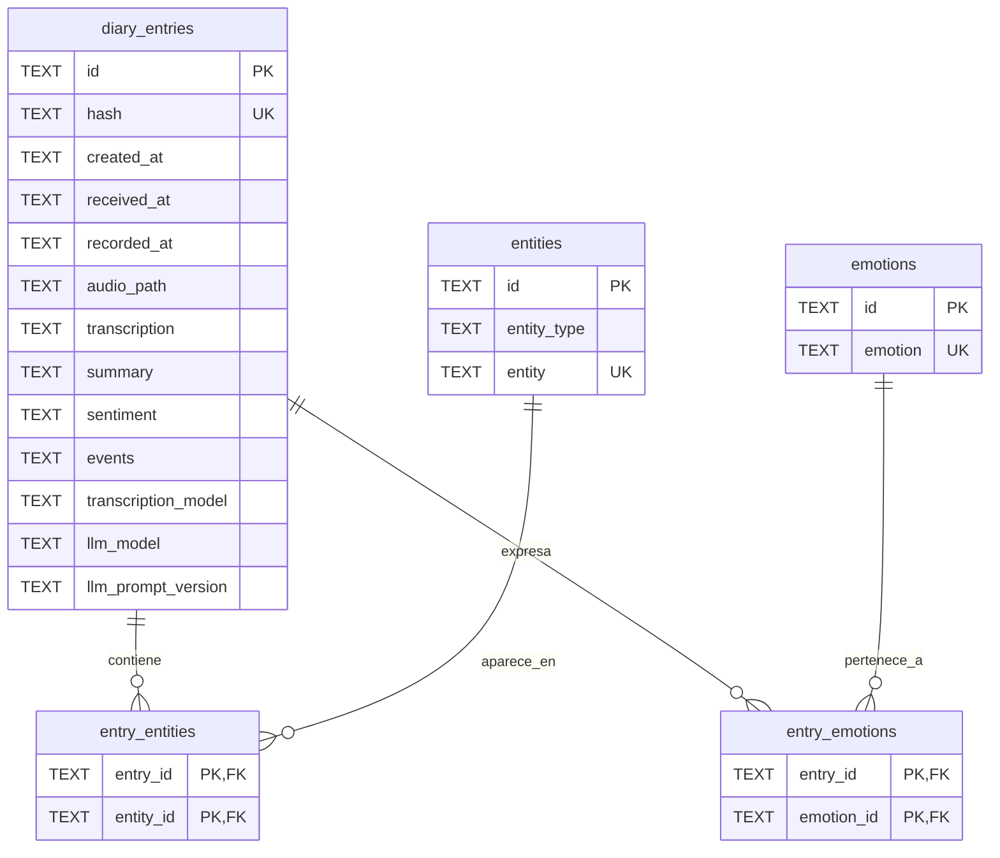

# dear-diary

**dear-diary** es un diario personal inteligente controlado desde Telegram. El bot recibe notas de voz, las transcribe localmente, analiza su contenido con un LLM y guarda la información estructurada en SQLite.

El flujo principal es:

```text
Audio de Telegram -> Whisper -> transcripción -> Ollama -> análisis -> SQLite -> informe por Telegram
```

El informe final incluye la transcripción, el resumen, el sentimiento, las emociones, las personas y los lugares detectados, además del tiempo empleado por la transcripción y el análisis LLM.

## Tecnologías

- **Python:** 3.12 o superior
- **Gestión del entorno:** [uv](https://docs.astral.sh/uv/)
- **Interfaz:** `python-telegram-bot`
- **Transcripción:** Transformers y Whisper, ejecutados localmente
- **Análisis:** Ollama con salida JSON validada mediante Pydantic
- **Persistencia:** SQLite

## Configuración

### Requisitos

- Python 3.12+
- `uv`
- Ollama instalado y ejecutándose
- Un modelo disponible en Ollama, por ejemplo `qwen3:1.7b`
- Un token creado con [BotFather](https://core.telegram.org/bots/tutorial#obtain-your-bot-token)

### Instalación

```bash
git clone <url-del-repositorio>
cd dear-diary
uv sync
```

Copia `.env.example` como `.env` y configura las variables:

```env
TELEGRAM_BOT_TOKEN=tu_token_de_telegram
TELEGRAM_USER_ID=tu_id_de_telegram
OLLAMA_MODEL=qwen3:1.7b
WHISPER_MODEL=openai/whisper-base
LOG_LEVEL=INFO
DATABASE_PATH=dear_diary.db
```

`DATABASE_PATH` puede ser una ruta relativa o absoluta. Si se omite, la base se crea como `dear_diary.db` en la raíz del proyecto.

`TELEGRAM_USER_ID` debe contener el identificador numérico de la cuenta de Telegram autorizada. El bot ignora cualquier interacción procedente de otro usuario, sin responder ni procesar el contenido.

## Ejecución

Ejecuta el bot desde la raíz del proyecto:

```bash
uv run python -m src.bot
```

En Telegram:

- `/start`: inicia el bot y desactiva la recepción de audios.
- `/help`: muestra los comandos disponibles.
- `/activar_audio`: activa la recepción de audios.
- `/detener_audio`: desactiva la recepción de audios.

Después de activar el modo de audio, envía una nota de voz o un archivo de audio. El bot descargará el archivo en `audios/`, lo transcribirá, analizará el texto y enviará un informe resumen.

## Scripts y módulos

| Archivo | Responsabilidad |
| --- | --- |
| [`src/bot.py`](src/bot.py) | Configura Telegram, gestiona comandos y audios, coordina transcripción, análisis, persistencia e informe final. |
| [`src/config.py`](src/config.py) | Carga `.env` y centraliza modelos, nivel de logs, directorio de audios y ruta de SQLite. |
| [`src/transcriber.py`](src/transcriber.py) | Carga Whisper y convierte un archivo de audio en texto en español. |
| [`src/llm/extractor.py`](src/llm/extractor.py) | Llama a Ollama y valida la respuesta con `DiaryAnalysis`. |
| [`src/llm/models.py`](src/llm/models.py) | Define el esquema de salida del análisis: resumen, sentimiento, emociones, personas, lugares y eventos. |
| [`src/llm/prompts.py`](src/llm/prompts.py) | Contiene el prompt del sistema, el prompt de análisis y la versión del prompt. |
| [`src/database.py`](src/database.py) | Crea las tablas SQLite y guarda entradas, entidades, emociones y relaciones. |
| [`dev.ipynb`](dev.ipynb) | Notebook de desarrollo y pruebas exploratorias. |
| [`test.ipynb`](test.ipynb) | Notebook de pruebas manuales. |

## Estructura de la base de datos

La base de datos utiliza cinco tablas. `diary_entries` es la tabla principal; las otras tablas normalizan entidades y emociones para que puedan reutilizarse entre varias entradas.



### Tablas

#### `diary_entries`

Guarda una entrada completa del diario:

- Identificación: `id` y `hash`.
- Fechas: `created_at`, `received_at` y `recorded_at`.
- Origen y contenido: `audio_path` y `transcription`.
- Análisis: `summary`, `sentiment` y `events`.
- Trazabilidad: `transcription_model`, `llm_model` y `llm_prompt_version`.

`events` se almacena como un array JSON serializado en SQLite.

#### `entities`

Catálogo reutilizable de entidades mencionadas en las transcripciones. Cada fila tiene un identificador, un tipo y un valor:

```text
id                  entity_type    entity
entity-id-1         person         Ana
entity-id-2         place          Valencia
```

Actualmente el bot registra los tipos `person` y `place`.

#### `entry_entities`

Tabla intermedia que relaciona cada entrada con las entidades que aparecen en ella. Su clave primaria compuesta evita duplicar una relación.

#### `emotions`

Catálogo reutilizable de emociones detectadas por el LLM.

#### `entry_emotions`

Tabla intermedia que relaciona cada entrada con sus emociones. Una misma emoción puede aparecer en muchas entradas.

## Salida del LLM

El análisis se valida con el modelo `DiaryAnalysis` y contiene:

- `summary`: resumen breve.
- `sentiment`: `positivo`, `negativo`, `neutral` o `mezclado`.
- `emotions`: lista de emociones detectadas.
- `people`: lista de personas mencionadas.
- `places`: lista de lugares mencionados.
- `events`: lista de acontecimientos o actividades relevantes.

La respuesta del LLM se limita mediante un esquema JSON y el prompt indica que no debe inventar información.

## Estructura del proyecto

```text
.
├── audios/
├── src/
│   ├── __init__.py
│   ├── bot.py
│   ├── config.py
│   ├── database.py
│   ├── transcriber.py
│   └── llm/
│       ├── __init__.py
│       ├── extractor.py
│       ├── models.py
│       └── prompts.py
├── dev.ipynb
├── test.ipynb
├── pyproject.toml
├── uv.lock
└── README.md
```

Los secretos deben mantenerse únicamente en `.env`, que no debe subirse al repositorio.
